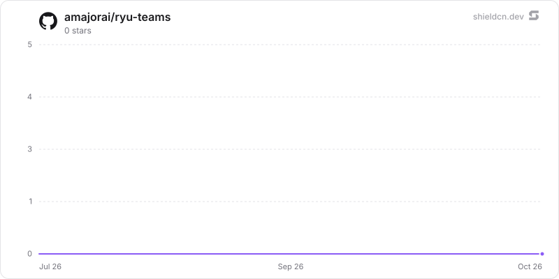

<div align="center">

# teams

</div>

A persisted, named, ordered collection of agents plus a coordination strategy, addressed as one unit via @team.

> **The public home of `ryu-teams`.** Source, builds, and releases live here —
> binaries for every platform are attached to each release.
>
> This tree is generated from the Ryu monorepo, so commits pushed here
> directly are replaced on the next sync. **Pull requests are welcome** —
> open them here and they are ported into the monorepo, then flow back out.
> Ryu as a whole: https://github.com/amajorai/ryu

## Install

**App:** [Install](ryu://apps/com.ryu.teams) (opens the Ryu desktop app and asks you to confirm)

**CLI:**

```bash
ryu apps add com.ryu.teams
```

**From source:**

```bash
cargo build --release --manifest-path backend/Cargo.toml
```

Prebuilt binaries for every platform are attached to [each release](https://github.com/amajorai/ryu/releases).

## License

Apache-2.0 — see [LICENSE](./LICENSE).

## Parts

- **`backend/` (`ryu-teams`)** — an extracted Core capability crate: the SQLite `TeamStore`
  (agent-id membership only) and the `/api/teams/*` HTTP surface. **The surface is now served
  OUT-OF-PROCESS** by the `ryu-teams` sidecar bin (below) via the manifest `public_mount` — there
  is no in-process `teams_routes` merge and no `teams` cargo feature. The crate stays a
	**non-optional path-dep** only for the group chat types the session loop consumes (see the
  weld below), not for the moved surface. This crate has **zero dependency on `apps/core`**: its
  only cross-cutting need, the data-dir path, is injected by the host at `TeamStore::open`.
- **`backend/src/main.rs` (`ryu-teams` bin)** — the same crate also builds a standalone
  **out-of-process sidecar** (`[[bin]] name = "ryu-teams"`): a loopback axum server that opens
  the node's `teams.db`, nests the crate's `routes()` under `/api/teams`, and gates every route
  with the Core-injected `RYU_EXT_TOKEN` bearer (fail-closed; `/health` is the one un-gated
  probe). It reuses the crate lib, so nothing is duplicated. Core spawns it via the
  `kind: local` sidecar spec in `@ryu/teams` (`RYU_TEAMS_BIN`/`RYU_TEAMS_PORT`, default
  `:8002`) and proxies `/api/teams/*` to it — exactly like `ryu-mail`.
- **`ui/`** — the self-contained Groups Companion. It lists and edits groups, manages members
  from the host's read-only agent catalog, selects coordination and lead-agent settings, and
  handles its own loading, recovery and confirmation states. Calls go through the
  capability-gated `window.ryu` bridge: `app.request` can reach only this app's sidecar,
  `registry.agents` exposes the agent catalog without credentials, and `ui.toast` reports
  completed mutations through the host notification system.
- **group chat orchestration stays in Core.** The session loop consumes only the shared
  `ryu-teams-contracts` records. The app crate and its HTTP implementation remain out of
  process; no Teams app code is linked into Core.

## Manifest (Core fixture)

- **id** `@ryu/teams`, with one HTML Companion runnable. The `app:http`,
  `core:list_agents`, and `ui:toast` grants cover its own-sidecar CRUD, member picker, and
  host toast feedback. It has no document or external-service dependency.
- **sidebar** The app contributes its live group list. Rows open the Companion, where group
  selection and creation stay app-owned instead of creating partial records in the shell.
- **contributes** three `hook_events` (`team.created`, `team.updated`, `team.deleted`),
  raised from `api.rs` via `ryu-app-events` so hooks and workflows can react to a roster
  change without polling. The HTTP surface is the right place to raise them because the
  sidecar owns `teams.db` outright: Core reaches it only through the capabilities below, so
  every mutation, including its own `agent_builder`'s, passes through those handlers once.
- **provides** `teams.resolve` (`POST /api/teams/resolve` with `{ "id" }`) and `teams.create`
  (`POST /api/teams`). Core's `@team` chat and `agent_builder.create_agent_team` consume these
  through its generic capability broker instead of naming this app.

## Surface

`/api/teams` (list/create) · `resolve` (capability read by id) · per-team `:id` ·
`:id/members` and `:id/members/:agent_id` (membership edits). Types: `TeamRecord`, `Coordination`, `CreateTeam`, `UpdateTeam`.

## Swap seam

Membership is agent-id references only, so any agent card can join any group; the
coordination strategy is a stored enum, not hardcoded behavior.

## At rest

`teams.db` seals each team's `name` and `description` (its instructions) per value
(`encb:v1:`, store `teams.db`, bound to the column and the team id) under the `@ryu/teams`
plugin subkey Core delivers to the sidecar (`crypto:seal` in the sidecar's `host_api.grants`).
Writes seal through the `ryu_seal` SQL function and reads open through `ryu_open`
(`src/seal_sql.rs`). The member list (agent ids), coordination strategy, lead agent id and
timestamps stay plaintext. Legacy plaintext rows are sealed when the store opens (resumable,
idempotent), then the WAL is truncated and freed pages are zeroed (`secure_delete` is on for
every connection). A team that does not open is left out of lists and counted (`/health`
`sealing.unreadable_rows`).
Key states (`backend/src/seal_keys.rs`):

- **Compat mode**: under an older Core that delivers no key, a never-sealed store keeps working
  in plaintext and `/health` reports `sealing.state = "compat"` ("waiting for a Ryu update").
- **No key or another key for a sealed store**: `sealing.state = "unhealthy"`, writes are
  refused and the data is kept.
- **Standalone** (no `RYU_PLUGIN_DATA_DIR`): `RYU_MASTER_KEY` if set, else a generated root in
  `<plugin data dir>/secrets/standalone-root.key` (0600) whose key check value is pinned.

The standalone satellite mirror builds `ryu-crypto` from crates.io at the declared version, so
the release train that ships this must publish `ryu-crypto` first (already ordered before app
backends in `tools/publish-crates.sh`).

## Star History

<a href="https://github.com/amajorai/ryu-teams/stargazers">
  <picture>
    <source media="(prefers-color-scheme: dark)" srcset="./.github/shieldcn/star-chart-dark.svg" />
    
  </picture>
</a>
